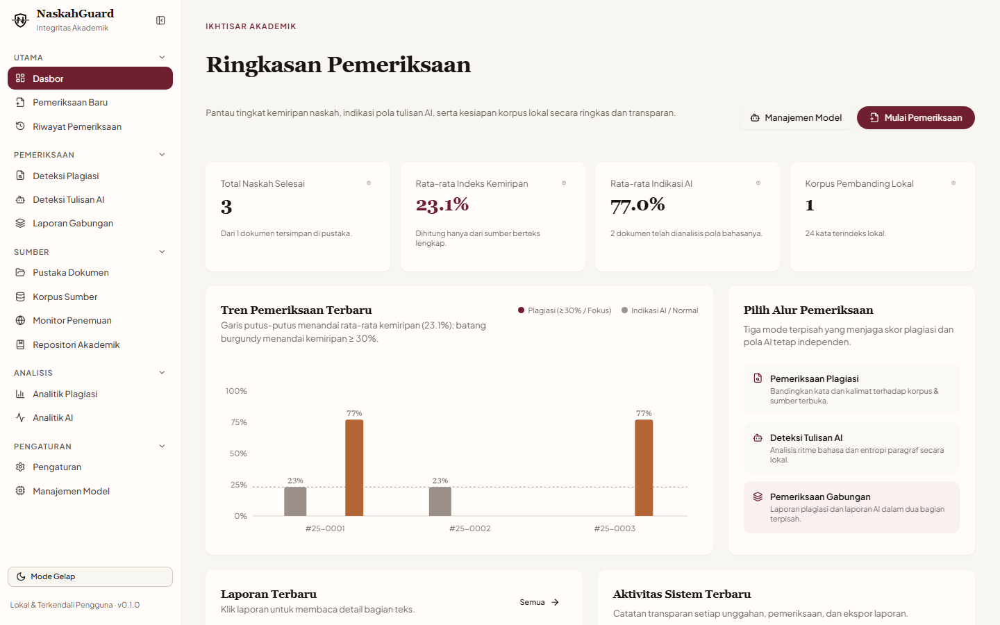
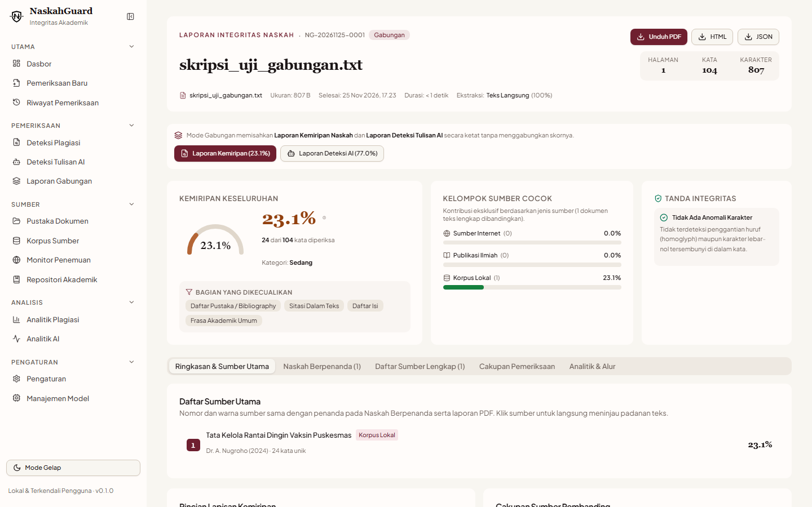
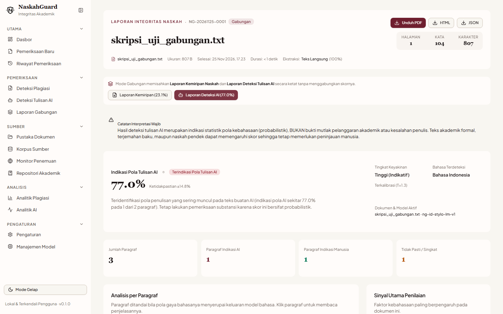
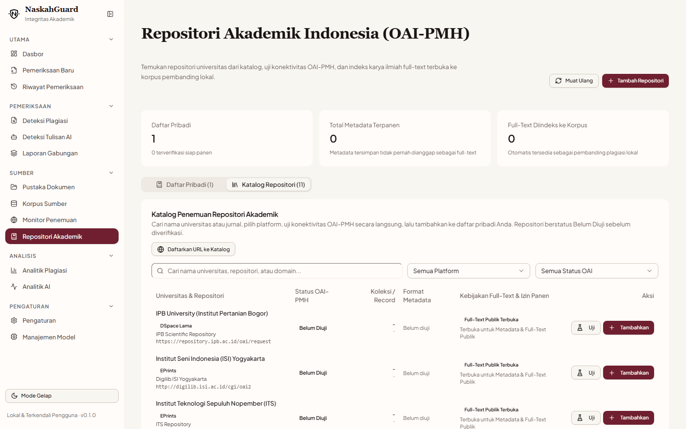

<div align="center">
  
  <p><strong>Sistem Pemeriksa Kemiripan Dokumen Akademik &amp; Deteksi Tulisan AI Mandiri (*Local-First*, Transparan, dan Open-Source)</strong></p>
  <p>
    Dirancang khusus untuk naskah akademik Bahasa Indonesia &amp; Inggris, dilengkapi mesin deteksi plagiasi 5 lapis, detektor tulisan AI lokal terkalibrasi, OCR Tesseract, laporan institusional PDF/HTML, serta Katalog &amp; Harvester Repositori Akademik Indonesia (OAI-PMH).
  </p>
</div>

> **Catatan Kejujuran & Batasan:** NaskahGuard **bukan** pengganti Turnitin/iThenticate, tidak mengklaim identik dengan layanan komersial tersebut, dan tidak mengakses basis data penerbit berbayar (*paywall*). Skor kemiripan dan skor kemungkinan AI bersifat indikatif sebagai alat bantu tinjauan akademik oleh manusia.

---

## Tampilan Antarmuka

| Dasbor Utama | Laporan Plagiasi Institusional |
|---|---|
|  |  |

| Laporan Deteksi AI Terpisah | Katalog Repositori Akademik Indonesia |
|---|---|
|  |  |

---

## Fitur Utama

### 1. Ingesti Dokumen & OCR Lokal
- Mendukung unggahan **PDF** (`PyMuPDF` dengan opsi `pypdf` non-AGPL), **DOCX** (`python-docx`), **TXT** (UTF-8 / CP1252), **HTML**, dan **XML**.
- **OCR Lokal Opsional (Tesseract `ind+eng`)**: Auto-discovery biner Tesseract di Windows disertai prapemrosesan halaman pindaian dan penandaan halaman OCR.
- **Keamanan Berkas**: Validasi ukuran, magic bytes, penolakan makro VBA DOCX, dan pemetaan offset karakter presisi.

### 2. Mesin Deteksi Kemiripan 5 Lapis & NLP Bahasa Indonesia
1. **Exact Matching**: Hash n-gram kata dengan perluasan rentang maksimal (*contiguous span merging*).
2. **Near-Exact Matching**: Sidik jari Winnowing (`k=5, w=4`), MinHash/LSH (`128` permutasi), dan *seed-and-extend alignment* konservatif.
3. **NLP Bahasa Indonesia (`indonesian_nlp.py`)**: Penanganan imbuhan, sinonim akademik, pengurutan klausa, dan pelindung *false-positive* istilah teknis.
4. **Lexical & Semantic (Opsional)**: TF-IDF `char_wb (3,5)` + BM25, serta *multilingual embeddings* (`sentence-transformers`) sebagai kandidat tinjauan terpisah.
5. **Rumus Transparan & Pengecualian Fleksibel**:
   $$\text{Similarity Index} = \frac{\text{Unique Matched Eligible Words}}{\text{Total Eligible Words}} \times 100\%$$
   Mendukung pengecualian **Daftar Pustaka / Bibliography** (termasuk *Bibliografi*, *References*, *Works Cited*), kutipan langsung, sitasi dalam teks, daftar isi, sampul, dan frasa akademik umum.

### 3. Pencarian Sumber Terbuka & Browser Crawler Terisolasi
- **Provider Akademik Resmi (default nonaktif sampai diaktifkan pengguna):** OpenAlex, Crossref, arXiv, Europe PMC, DOAJ, dan pencarian web opsional via **SearXNG** lokal ([docker-compose.searxng.yml](docker-compose.searxng.yml)).
- **Browser Crawler Terisolasi:** Menggunakan konteks Chromium Playwright tanpa profil pribadi/cookie, mematuhi `robots.txt`, proteksi **SSRF** ketat (termasuk pada redirect), dan ekstraksi PDF publik (`citation_pdf_url`).

### 4. Deteksi Tulisan AI Lokal (`ng-id-stylo-lm-v1`)
- Berjalan 100% lokal di CPU tanpa API eksternal berbayar menggunakan analisis stilometri ID/EN, entropi n-gram karakter, dan *burstiness* per paragraf.
- **3 Mode Pemeriksaan Terpisah (`PLAGIARISM_ONLY`, `AI_ONLY`, `COMBINED`):** Skor AI tidak pernah dicampur ke *Similarity Index* plagiasi.
- **Guardrail Ketat:** Teks di bawah 80 kata otomatis ditandai `INSUFFICIENT_DATA` (`Tidak Cukup Bukti`); kategori `MIXED_UNCERTAIN` dipertahankan untuk mencegah vonis otomatis keliru.

### 5. Katalog & Harvester Repositori Akademik Indonesia (OAI-PMH 2.0)
- **Dukungan Platform:** OJS (`/index.php/{jurnal}/oai`, `/{jurnal}/oai`), DSpace 7 (`/server/oai/request`), DSpace Lama (`/oai/request`, `/dspace-oai/request`), EPrints (`/cgi/oai2`), dan arXiv OAI-PMH.
- **Wizard Uji Koneksi 8 Tahap:** Validasi URL → HTTP → `Identify` → `ListMetadataFormats` → `ListSets` → `ListRecords` → Validasi Metadata → Deteksi PDF, lengkap dengan kode error & saran solusi Bahasa Indonesia.
- **Katalog Penemuan Repositori (`/repositories`):** Cari nama universitas, daftar endpoint manual, uji konektivitas sebelum aktif (`UNVERIFIED` secara default), lihat koleksi & format metadata, lalu tambahkan ke daftar pribadi.
- **Panen Lanjutan & Kontrol Batas:** Filter koleksi (`setSpec`), rentang tahun, kata kunci, jenis dokumen, batas rekaman & batas unduhan PDF (`max_downloads`), *Pause/Resume*, *Retry Failed*, dedup DOI/hash/URL, penjadwalan berkala opsional, serta **provenance lengkap** yang otomatis terindeks ke korpus pembanding lokal (metadata saja tidak pernah dihitung sebagai full-text).

### 6. Laporan Institusional & Ekspor
- Laporan Web dua panel dengan *highlight* warna per sumber + pil bernomor di margin kiri, Tanda Integritas (deteksi *homoglyph* & karakter tersembunyi), akordeon penjelasan perhitungan skor + pembulatan, serta ekspor **PDF**, **HTML mandiri**, dan **JSON**.

---

## Arsitektur & Teknologi

| Lapisan | Teknologi |
|---|---|
| **Backend API & Worker** | Python 3.10+, FastAPI, Uvicorn, SQLAlchemy, Alembic, Pydantic |
| **Basis Data** | SQLite (default lokal WAL mode, 5 migrasi Alembic hingga `0005`) — opsional PostgreSQL |
| **Ekstraksi & OCR** | PyMuPDF (`pymupdf`) / `pypdf`, `python-docx`, `defusedxml`, Tesseract OCR (`pytesseract`) |
| **Mesin NLP & Matching** | Winnowing, MinHash LSH (`datasketch`), `scikit-learn`, `numpy`, model lokal `ng-id-stylo-lm-v1` |
| **Crawling & Browser** | `httpx`, Playwright Chromium terisolasi |
| **Frontend UI** | React 18, TypeScript, Vite, Tailwind CSS, `shadcn/ui`, `lucide-react` |

---

## Cara Menjalankan di Windows

### Prasyarat
- **Python 3.10+**
- **Node.js 20+**
- *(Opsional)* **Tesseract OCR** (`ind` + `eng`) untuk PDF hasil pindaian
- *(Opsional)* **Docker Desktop** jika ingin menjalankan instance SearXNG lokal

### 1. Instalasi Otomatis
```powershell
.\scripts\setup.ps1
```

### 2. Menjalankan Aplikasi Lokal
```powershell
.\scripts\dev.ps1
```
Atau jalankan secara manual di dua terminal terpisah:

```powershell
# Terminal 1 — Backend FastAPI
cd backend
.\.venv\Scripts\python.exe -m uvicorn app.main:app --host 127.0.0.1 --port 8000

# Terminal 2 — Frontend Vite
cd frontend
npm run dev
```
Buka browser ke `http://127.0.0.1:5173`.

### 3. Impor Korpus Lokal via CLI
```powershell
cd backend
.\.venv\Scripts\python.exe -m app.cli import-corpus ..\samples --source-type contoh_lokal
```

### 4. Konfigurasi Lingkungan
Salin [backend/.env.example](backend/.env.example) ke `backend/.env` bila ingin mengubah konfigurasi (seluruh variabel memakai prefix `NG_`, misalnya `NG_API_TOKEN`, `NG_SEARXNG_URL`, `NG_PDF_BACKEND`, `NG_TESSERACT_CMD`).

---

## Pengujian & Verifikasi

```powershell
# 1. Suite unit & integrasi backend (Phase 1–10.4)
cd backend
.\.venv\Scripts\python.exe -m pytest -v

# 2. Build produksi frontend (TypeScript + Vite)
cd frontend
npm run build

# 3. Validasi platform OAI-PMH Indonesia secara live (terpisah dari mock)
.\backend\.venv\Scripts\python.exe benchmark\run_phase10_4_live_platform_validation.py

# 4. End-to-End Playwright UI QA (desktop, tablet, mobile, mode terang/gelap)
.\backend\.venv\Scripts\python.exe benchmark\run_phase10_ui_qa.py
```

### Ringkasan Hasil Pengujian Terakhir (Phase 10.4)
- **Pytest Backend:** `59 passed, 1 skipped, 0 failed` (`1 test_live_internet_providers_explicit` hanya berjalan bila flag live diaktifkan).
- **Validasi OAI-PMH Live:**
  - **OJS** (`journal.uny.ac.id/index.php/jpvo/oai`): Tervalidasi full-text hingga uji plagiasi (`94.53%` SI).
  - **EPrints** (`digilib.uin-suka.ac.id/cgi/oai2`): Tervalidasi full-text hingga uji plagiasi (`94.44%` SI).
  - **DSpace Lama** (`repository.ipb.ac.id/oai/request`): Protokol & penemuan URL PDF tervalidasi; pengunduhan berkas terbatas ditangani jujur sebagai *metadata-only*.
  - **DSpace 7**: Demo resmi (`demo.dspace.org/server/oai/request`) tervalidasi protokol/metadata; `digilib.stikomyos.ac.id` mengalami *timeout* pada jaringan uji saat ini dan didokumentasikan jujur.
- **Playwright UI QA:** `18/18` pengecekan viewport/rute lulus dengan `0` error konsol, `0` page error, dan `0` HTTP `5xx`.

---

## Struktur Proyek

```text
NaskahGuard/
├── backend/
│   ├── alembic/              # Migrasi skema SQLite (0001 s.d. 0005)
│   ├── app/
│   │   ├── ai_detection/     # Engine deteksi tulisan AI lokal & model registry
│   │   ├── api/              # Endpoint REST FastAPI (checks, reports, corpus, oai, providers, dll.)
│   │   ├── engine/           # Pipeline matching, Winnowing, MinHash LSH, scoring, Indonesian NLP
│   │   ├── ingestion/        # Ekstraktor PDF/DOCX/TXT/HTML/XML, OCR Tesseract, segmentasi struktur
│   │   ├── reports/          # Pembangun laporan Web, PDF, HTML, JSON & integrity flags
│   │   └── sources/          # OAI-PMH client/harvester, Katalog RI, OpenAlex, Crossref, arXiv, DOAJ, SSRF
│   └── tests/                # Suite pengujian pytest (mock & integrasi)
├── frontend/
│   ├── public/brand/         # Aset ikon & logo aplikasi Web
│   └── src/
│       ├── components/       # Komponen UI (shadcn/ui, OAIWizardView, Layout, dll.)
│       └── pages/            # Halaman aplikasi (Dashboard, NewCheck, ReportDetail, Repositories, dll.)
├── benchmark/                # Skrip evaluasi AI, OCR, search, live OAI validation & Playwright QA
├── docs/                     # Dokumentasi arsitektur, audit, benchmark, & laporan QA per fase
├── samples/                  # Dokumen contoh untuk uji awal
├── scripts/                  # Skrip setup, dev, smoke test Windows
├── docker-compose.searxng.yml
├── LICENSE
└── THIRD_PARTY_NOTICES.md
```

---

## Dokumentasi Lengkap

- **Arsitektur & Spesifikasi:** [ARCHITECTURE.md](docs/ARCHITECTURE.md), [API_DOCUMENTATION.md](docs/API_DOCUMENTATION.md), [DATABASE_SCHEMA.md](docs/DATABASE_SCHEMA.md), [SECURITY_AND_PRIVACY.md](docs/SECURITY_AND_PRIVACY.md)
- **Mesin Kemiripan & Skor:** [ALGORITHM_DESIGN.md](docs/ALGORITHM_DESIGN.md), [SIMILARITY_SCORING.md](docs/SIMILARITY_SCORING.md), [SOURCE_DISCOVERY.md](docs/SOURCE_DISCOVERY.md)
- **Deteksi AI & OCR:** [AI_DETECTION_ARCHITECTURE.md](docs/AI_DETECTION_ARCHITECTURE.md), [PHASE10_2_AI_VALIDATION.md](docs/PHASE10_2_AI_VALIDATION.md), [PHASE10_2_OCR_REPORT.md](docs/PHASE10_2_OCR_REPORT.md)
- **Repositori Akademik Indonesia (Phase 10.3–10.4):** [PHASE10_3_REPOSITORY_AUDIT.md](docs/PHASE10_3_REPOSITORY_AUDIT.md), [PHASE10_4_PLATFORM_VALIDATION.md](docs/PHASE10_4_PLATFORM_VALIDATION.md), [PHASE10_4_REPOSITORY_CATALOG.md](docs/PHASE10_4_REPOSITORY_CATALOG.md), [PHASE10_4_HARVEST_REPORT.md](docs/PHASE10_4_HARVEST_REPORT.md), [PHASE10_4_QA_REPORT.md](docs/PHASE10_4_QA_REPORT.md)

---

## Lisensi & Atribusi

Lihat [LICENSE](LICENSE) dan [THIRD_PARTY_NOTICES.md](THIRD_PARTY_NOTICES.md). Gunakan flag `NG_PDF_BACKEND=pypdf` jika memerlukan konfigurasi bebas dependensi AGPL-3.0 (`pymupdf`).
