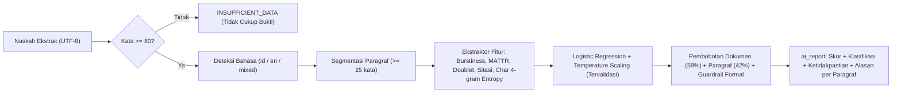

# Arsitektur Deteksi Tulisan AI (NaskahGuard Phase 10)

Dokumen ini menjelaskan desain teknis modul **AI Writing Detection** lokal pada `backend/app/ai_detection/` dan integrasinya dengan alur pemeriksaan NaskahGuard.

---

## 1. Prinsip Desain Utama

1. **Terpisah Ketat dari Kemiripan Plagiasi**
   Skor AI tidak pernah ditambahkan, dirata-rata, atau mencemari `similarity_index`. Kolom basis data (`checks.mode` dan `checks.ai_report` pada migrasi Alembic `0003`) dan tampilan laporan dipisahkan secara eksplisit.
2. **Offline-First & CPU-Friendly (Windows)**
   Engine bawaan (`ng-id-stylo-lm-v1`) berjalan sepenuhnya secara luring di CPU Windows (`scikit-learn` + `numpy`, RAM ~64 MB, waktu proses ~1,2 ms per naskah) tanpa memaksa pemasangan PyTorch CUDA 2+ GB.
3. **Output Probabilistik Konservatif**
   Hasil selalu disajikan sebagai **indikasi pola penulisan AI** disertai tingkat ketidakpastian (`±%`), penjelasan fitur per paragraf, serta perlindungan `INSUFFICIENT_DATA` (*Tidak Cukup Bukti*) bila kata bermakna `< 80` kata.

---

## 2. Perbandingan Hasil Audit Tiga Repositori Referensi

| Aspek | `eric-mitchell/detect-gpt` | `Croups/is-it-ai` | `ae-saouiqui/ai-text-detection` | Keputusan Adopsi NaskahGuard |
| :--- | :--- | :--- | :--- | :--- |
| **Metode Utama** | Kurvatur log-probabilitas + 10–100 perturbasi `T5` | *Fast-DetectGPT* (1 forward pass + sampling) + kalibrasi 2-Gaussian | Encoder *fine-tuned* (`mELECTRA`, `mDistilBERT`, LoRA) + tuning threshold PR | Mengadopsi konsep entropi/prediktabilitas + analisis per paragraf + kalibrasi lokal terpisah |
| **Kompatibilitas Windows CPU** | Berat & lambat (puluhan forward pass) | Menengah–Berat (`Python >=3.13`, `Qwen/Qwen2.5-3B` ~6 GB RAM) | Berat (CUDA `torch==2.6+cu124`) | Engine utama tetap ringan di CPU; adapter Transformer dijadikan opsi di **Manajemen Model** |
| **Dukungan Bahasa Indonesia** | Inggris (`WritingPrompts`, `XSum`, `SQuAD`) | Fokus Inggris; butuh kalibrasi ulang lokal | Inggris & Prancis (tanpa Bahasa Indonesia) | Dataset multibahasa **ID + EN** dibangun khusus beserta fitur morfologi & penanda wacana lokal |
| **Lisensi** | MIT (`LICENSE`) | MIT (`LICENSE`) | Tidak ada file `LICENSE` pada root repo | Tidak menyalin kode/bobot tak berlisensi; seluruh implementasi & bobot kalibrasi ditulis mandiri |

Detail teknis tiap berkas audit dicatat pada [.agents/skills/ai-writing-detection/references/repo_audit_and_calibration.md](../../.agents/skills/ai-writing-detection/references/repo_audit_and_calibration.md).

---

## 3. Arsitektur Komponen (`backend/app/ai_detection/`)

### Fitur yang Diekstrak (`features.py`)
1. **Variansi Panjang Kalimat (*Burstiness*)**: `sentence_len_cv`, rasio panjang min/maks (`sentence_len_min_max_ratio`), dan rasio kalimat singkat (`<= 12` kata).
2. **Keanekaragaman Leksikal**: *Moving-Average Type-Token Ratio* (`mattr_35`), `opener_diversity` (keberagaman awal kalimat), dan panjang kata rata-rata.
3. **Penanda Stilistika LLM vs Spesifisitas Manusia**: `ai_marker_rate`, pasangan kata sifat simetris (`symmetric_doublet_rate`), vs `human_anchor_rate` (pengamatan lapangan), `cite_number_rate` (tahun/pasal/angka empiris), dan `expressive_punct_rate`.
4. **Entropi N-Gram Lokal (`NgramEntropyModel`)**: Model karakter 4-gram yang dilatih *hanya* pada data `train` untuk mengukur keterdugaan susunan karakter tanpa menghafal topik spesifik.

---

## 4. Alur Mode Pemeriksaan (`pipeline.py` & `api/checks.py`)

| Mode (`check_mode`) | Proses Backend | Isi Laporan |
| :--- | :--- | :--- |
| `PLAGIARISM_ONLY` | Menjalankan 12 tahap deteksi kemiripan plagiasi | `metrics` + `sources` + `matches` (`ai_report = null`) |
| `AI_ONLY` | Hanya mengekstrak teks & menjalankan `analyze_document_ai()` | `ai_report` terstruktur (`similarity_index = 0.0`, nol sumber) |
| `COMBINED` | Menjalankan kedua mesin secara independen | Laporan terbagi menjadi dua tab terpisah tanpa penggabungan angka |
