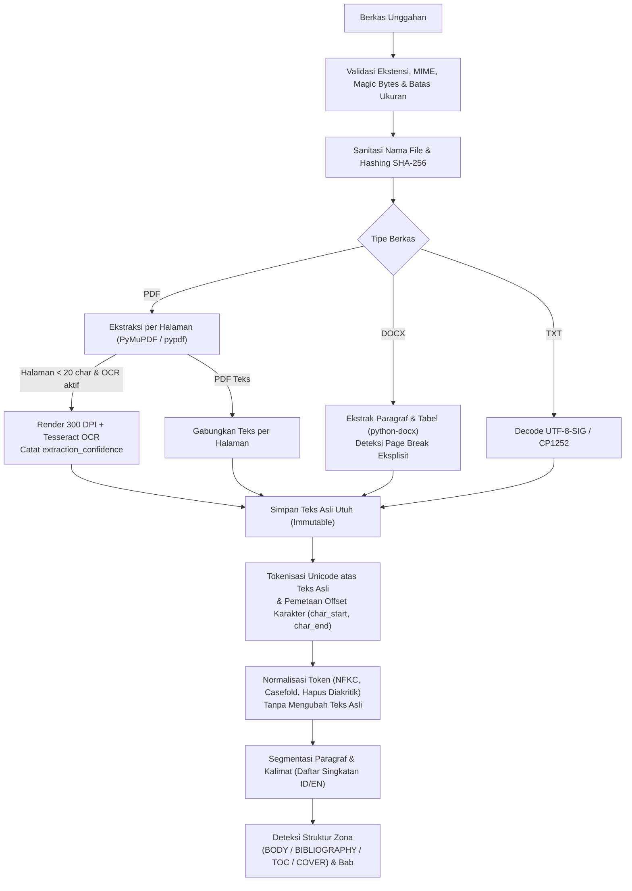
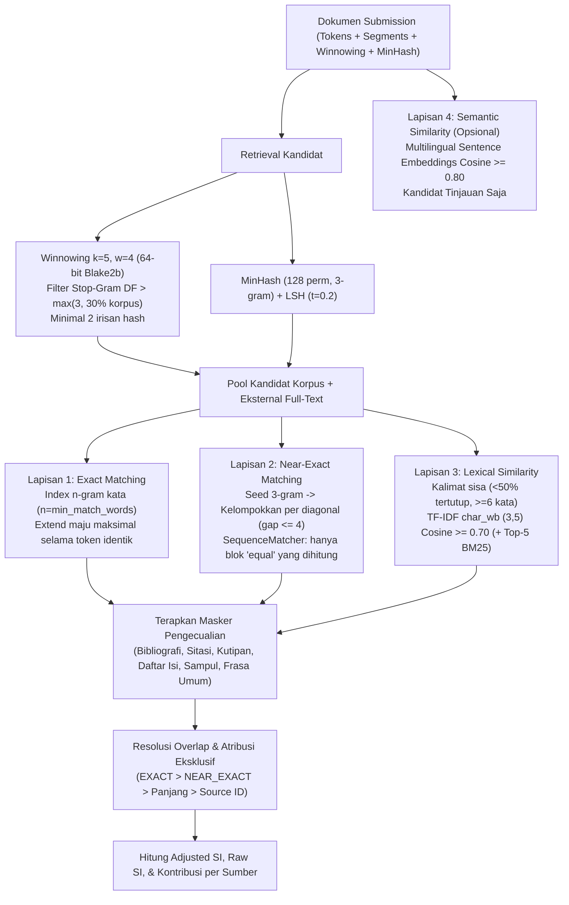

# Desain Algoritma — NaskahGuard

## 1. Alur Pemrosesan Dokumen (Document Processing Flow)

## 2. Alur Deteksi Kemiripan Multi-Lapis (Similarity Detection Flow)

## 3. Rincian Teknis Tiap Lapisan

### A. Hashing & Winnowing
- Tokenisasi kata menggunakan ekspresi reguler Unicode `\w+(?:[-'’]\w+)*`.
- Setiap token dinormalisasi (NFKC, casefold, penghapusan tanda diakritik kombinasi, penyatuan ligatur) sementara offset karakter (`char_start`, `char_end`) menunjuk persis ke teks asli.
- Hash 64-bit dihitung menggunakan `blake2b(digest_size=8)` atas gabungan k-gram kata (`k = 5`) dan dikonversi ke bilangan bulat bertanda 64-bit agar kompatibel dengan kolom `BIGINT` SQLite dan PostgreSQL.
- Pemilihan fingerprint menggunakan algoritma **Winnowing** (Schleimer, Wilkerson, Aiken 2003) dengan ukuran jendela `w = 4` dan aturan pemilihan nilai hash terkecil paling kanan (*rightmost minimum*).
- **Alternatif Skala Besar (PostgreSQL + Noplag Pattern)**: Pada korpus jutaan segmen di PostgreSQL, fingerprint dapat disimpan sebagai kolom `bigint[]` terindeks GIN (`array_ops`) sebagaimana diimplementasikan pada Noplag Engine.

### B. Exact Matching (Lapisan 1)
- Membangun indeks posisi n-gram kata sumber berukuran `n = min_match_words` (default 8).
- Untuk setiap posisi kecocokan `(i, j)` yang bukan kelanjutan langsung dari `(i-1, j-1)`, rentang diperluas maju selama token ter-normalisasi identik.
- Rentang dengan panjang `>= min_match_words` disimpan dan dideduplikasi per sumber.

### C. Near-Exact Matching (Lapisan 2)
- Seed dibangun dari 3-gram kata yang sama antara submission dan kandidat.
- Seed dikelompokkan berdasarkan selisih diagonal kasar dan digabungkan apabila jarak antar seed `<= 4` token pada kedua sisi.
- Wilayah kandidat yang panjangnya `>= min_match_words`, memiliki kepadatan seed `>= 0.5`, dan belum tertutup penuh oleh Lapisan 1 diselaraskan dengan `difflib.SequenceMatcher(autojunk=False)`.
- Demi ketepatan audit, **hanya token pada blok `equal`** dihitung sebagai kata cocok (meskipun highlight region dapat menampilkan konteks wilayah modifikasi).

### D. Lexical & Semantic (Lapisan 3 & 4)
- **Lapisan 3 (Lexical)**: Kalimat submission dengan cakupan exact/near `< 50%` dan panjang `>= 6` kata dibandingkan menggunakan `TfidfVectorizer(analyzer="char_wb", ngram_range=(3, 5))` dengan ambang cosine `>= 0.70`. Kandidat diambil dari pool L1/L2 ditambah top-5 dokumen dari ranking BM25 (`rank-bm25`).
- **Lapisan 4 (Semantic)**: Nonaktif secara default. Bila diaktifkan dan pustaka `sentence-transformers` terpasang, menggunakan model multibahasa (`paraphrase-multilingual-MiniLM-L12-v2`) dengan ambang cosine `>= 0.80`. Hasil Lapisan 4 **tidak pernah** masuk ke Similarity Index utama dan dilabeli sebagai kandidat untuk ditinjau.
