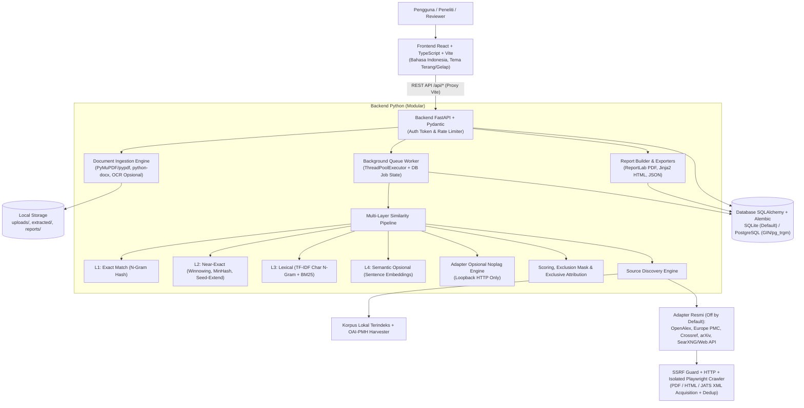

# Arsitektur Sistem — NaskahGuard

## 1. Gambaran Umum
NaskahGuard menggunakan arsitektur monolit modular yang memisahkan lapisan antarmuka (React + Vite), API & antrean latar belakang (FastAPI + Worker), modul ingesti dokumen, mesin similarity multi-lapis, adapter penemuan sumber, penyimpanan data relasional + berkas lokal, serta generator laporan.

## 2. Diagram Arsitektur Sistem

## 3. Diagram Aliran Data (Data Flow)

```mermaid
flowchart LR
    File["Berkas Unggahan<br/>(PDF / DOCX / TXT)"] --> Validate["Validasi Ekstensi,<br/>Magic Bytes & Ukuran"]
    Validate --> SaveRaw["Simpan Berkas Aman<br/>(UUID filename)"]
    SaveRaw --> Extract["Ekstraksi Teks Asli +<br/>Metadata + Posisi Halaman"]
    Extract --> SaveExtracted["Simpan JSON Terstruktur<br/>(Teks Asli + Token + Offset)"]
    SaveExtracted --> IndexCorpus{"Peran Dokumen?"}
    IndexCorpus -->|"CORPUS / EXTERNAL"| PersistIndex["Simpan Segmen, Winnowing<br/>Fingerprints & MinHash"]
    IndexCorpus -->|"SUBMISSION"| CreateCheck["Buat Job Check (QUEUED)"]
    CreateCheck --> MatchEngine["Jalankan Pipeline Similarity<br/>(L1-L4 + Exclusions)"]
    PersistIndex --> MatchEngine
    MatchEngine --> PersistResults["Simpan Matches, CheckSources,<br/>Metrics & Stage Counts"]
    PersistResults --> Render["Viewer Interaktif & Ekspor<br/>(PDF / HTML / JSON)"]
```

## 4. Keputusan Desain & Keterbatasan Lingkungan
1. **Basis Data Portabel (SQLite Default, PostgreSQL Siap Pakai)**: SQLite dipilih sebagai default agar NaskahGuard langsung berjalan di Windows tanpa instalasi server DB terpisah. Skema SQLAlchemy dan migrasi Alembic mendukung PostgreSQL beserta ekstensi `pg_trgm` dan indeks GIN secara otomatis saat `DATABASE_URL` mengarah ke PostgreSQL.
2. **Worker Antrean Latar Belakang**: Pemrosesan pemeriksaan berjalan asinkron melalui `ThreadPoolExecutor` dan status persisten di tabel `checks` (`QUEUED`, `PROCESSING`, `COMPLETED`, `FAILED`). Saat aplikasi dimulai ulang, tugas yang tertunda dipulihkan kembali.
3. **Pemisahan Service Noplag Engine**: Jika pengguna menjalankan Noplag Engine secara lokal pada PostgreSQL, `NoplagAdapter` dapat diaktifkan melalui `NOPLAG_ENGINE_URL` yang dibatasi ketat pada host loopback (`127.0.0.1`/`localhost`).

---

## Pembaruan Arsitektur Phase 8

- **Frontend Modular**: Penambahan lapisan token CSS terpusat (`styles/tokens.css`), utilitas format durasi (`utils/format.ts`), rute `/repositories` (OAI-PMH Registry) dan `/analytics` (Analitik lintas pemeriksaan), serta komponen shell collapsible sidebar di `Layout.tsx`.
- **Search Intelligence Layer**: Penambahan modul `sources/ranking.py` (klasifikasi relevansi pra-akuisisi) dan `sources/cache.py` (TTL cache URL & resolusi DOI), serta pengunduhan konkuren terbatas di `sources/registry.py`.
- **Telemetry & Scoring Audit**: Penambahan `metrics.score_explanation`, `metrics.stage_timings_ms`, `coverage.source_metrics` (9 metrik eksplisit), dan telemetri kesehatan provider pada `GET /api/providers`.

---

## Pembaruan Arsitektur Phase 9

- **Frontend Design System Layer**: Integrasi `shadcn/ui` (`frontend/src/components/ui/*`, Radix Primitives, `components.json`) dan `Magic UI` selektif (`NumberTicker`, `BlurFade`) di atas token semantik `tokens.css` & `theme.css` tanpa *CSS preflight collision*.
- **Browser Extraction Interface (`backend/app/sources/browser_extractor.py`)**: Abstraksi `BrowserExtractor` dan implementasi `IsolatedPlaywrightExtractor` (`extract()`, `health_check()`) yang menggabungkan streaming HTTP, ekstraksi HTML berbasis kepadatan teks, resolusi otomatis meta `citation_pdf_url` Open Access, serta fallback Chromium terisolasi (`storage_state=None`).
- **Academic Search & Live Diagnostics**: Penambahan adapter `DOAJProvider` (`sources/doaj.py`) dan diagnostik konektivitas live `POST /api/providers/diagnostics` di `api/providers.py`.
- **Indonesian NLP Layer (`backend/app/engine/indonesian_nlp.py`)**: Stemming morfologi Bahasa Indonesia, pemetaan sinonim akademik non-teknis, ketahanan urutan klausa, dan proteksi jargon teknis pada Layer 3 (`LEXICAL`).
