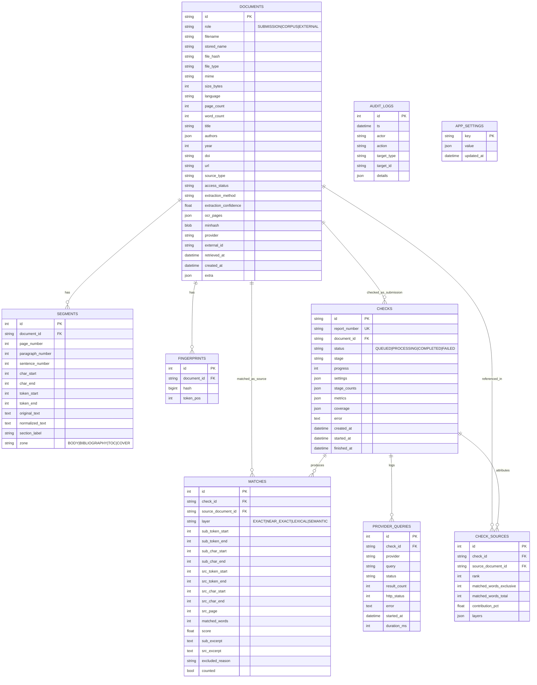

# Skema Basis Data — NaskahGuard

## 1. Diagram ERD (Entity-Relationship Diagram)

## 2. Dukungan Dialek SQLite & PostgreSQL
- **SQLite (Default)**: Mode WAL (`PRAGMA journal_mode=WAL`) dan `busy_timeout=5000` agar akses baca API dan penulisan worker latar belakang berjalan aman bersamaan. Indeks B-tree pada `fingerprints(hash)` mempercepat lookup kandidat.
- **PostgreSQL (Opsional Produksi)**: Migrasi Alembic mendeteksi dialek `postgresql` secara otomatis untuk membuat ekstensi `pg_trgm` dan indeks GIN trigram (`gin_trgm_ops`) pada `segments.normalized_text`, serta opsional ekstensi `pgvector` apabila `ENABLE_PGVECTOR=true`.
