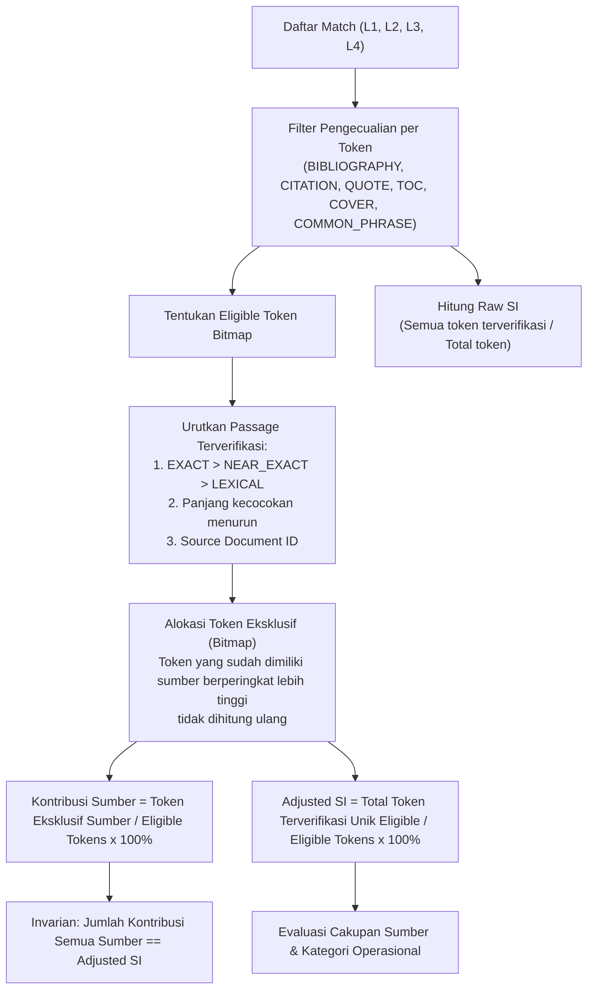

# Desain Perhitungan Skor Kemiripan — NaskahGuard

## 1. Rumus Utama Similarity Index

$$\text{Similarity Index (Adjusted)} = \frac{|\text{Matched Eligible Tokens}|}{|\text{Eligible Tokens}|} \times 100\%$$

$$\text{Raw Similarity} = \frac{|\text{All Matched Tokens}|}{|\text{Total Tokens}|} \times 100\%$$

Di mana:
- **Total Tokens**: Seluruh token kata hasil tokenisasi dokumen submission.
- **Eligible Tokens**: Token yang tidak termasuk ke dalam masker pengecualian yang diaktifkan pengguna.
- **Matched Tokens**: Gabungan (operasi himpunan *union* berbasis indeks token) seluruh token yang terverifikasi cocok oleh Lapisan 1 (`EXACT`) dan Lapisan 2 (`NEAR_EXACT`), serta Lapisan 3 (`LEXICAL`) **hanya jika** opsi `include_lexical_in_index` diaktifkan secara eksplisit.

## 2. Alur Perhitungan Skor & Atribusi Eksklusif

## 3. Aturan Pengecualian (Exclusions)

| Pengaturan | Default | Mekanisme Deteksi |
|---|---|---|
| `exclude_bibliography` | `true` | Zona `BIBLIOGRAPHY` dari deteksi heading (`Daftar Pustaka`, `Referensi`, `Bibliography`, `References`, dll.) hingga `Lampiran`/`Appendix` atau akhir dokumen. |
| `exclude_citations` | `true` | Pola sitasi dalam teks seperti `(Nama, 2023)`, `(Nama dkk., 2022: 15)`, `[1]`, `[1, 2]`, `[3-5]`. |
| `exclude_quotes` | `false` | Teks di dalam tanda kutip (`"..."`, `“...”`, `«...»`) dengan minimal 3 kata. |
| `exclude_toc` | `true` | Halaman berheading `Daftar Isi` / `Table of Contents` atau halaman dengan `>= 3` baris titik-titik diikuti nomor halaman. |
| `exclude_cover` | `false` | Halaman 1 (jika dokumen > 1 halaman) atau segmen sebelum page break pertama pada DOCX. |
| `exclude_common_phrases` | `true` | Kemunculan frasa dari kamus frasa akademik umum (`common_phrases_id.txt` & `common_phrases_en.txt`) dan n-gram dengan frekuensi dokumen tinggi di korpus. |
| `min_match_words` | `8` | Rentang kecocokan minimum (dapat dikonfigurasi 3–50 kata). |

## 4. Kategori Operasional & Batasan Interpretasi
- **Rendah**: `Adjusted SI < THRESHOLD_LOW` (default 15%).
- **Sedang**: `THRESHOLD_LOW <= Adjusted SI < THRESHOLD_HIGH` (default 30%).
- **Tinggi**: `Adjusted SI >= THRESHOLD_HIGH`.

> **Penegasan**: Kategori di atas merupakan **kategori operasional aplikasi yang dapat dikonfigurasi**, bukan standar resmi universitas atau penerbit, dan **bukan keputusan otomatis pelanggaran plagiasi**. Jika cakupan sumber terbatas atau tidak ditemukan kecocokan, sistem menyatakan bahwa hal tersebut **tidak berarti dokumen bebas plagiasi**.
