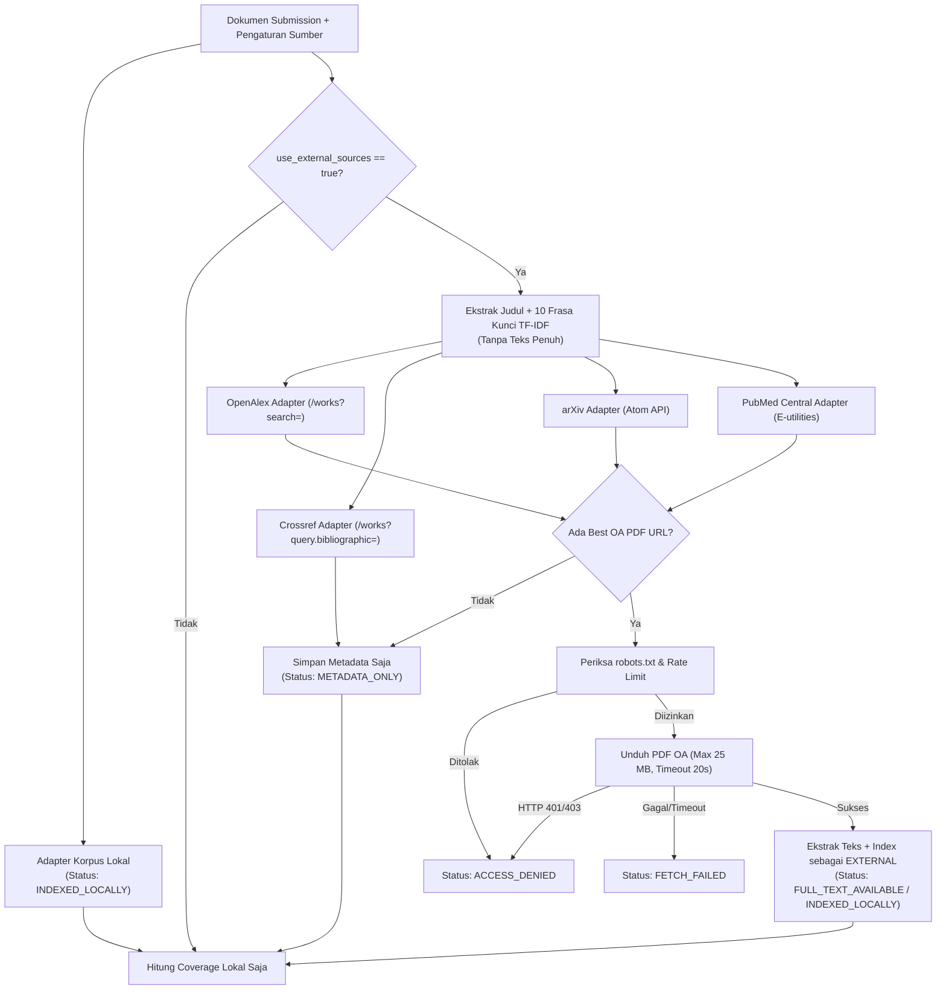

# Mesin Penemuan Sumber (Source Discovery) — NaskahGuard

## 1. Prinsip & Kebijakan Akses
- **Default Off untuk Sumber Eksternal**: Pemeriksaan default hanya membandingkan terhadap **Korpus Lokal**. Pencarian ke sumber eksternal (`use_external_sources = true`) hanya aktif jika diaktifkan secara sadar oleh pengguna.
- **Perlindungan Privasi Kueri**: NaskahGuard **tidak pernah mengirimkan isi dokumen penuh** ke penyedia eksternal. Kueri pencarian dibentuk hanya dari judul dokumen dan maksimal 10 frasa kunci hasil ekstraksi TF-IDF.
- **Kejujuran Cakupan**: Sumber yang hanya menyediakan metadata atau abstrak dicatat dengan status `METADATA_ONLY` dan **tidak pernah dihitung** sebagai dokumen *full-text* yang sudah dibandingkan.

## 2. Alur Penemuan Sumber

## 3. Aturan & Rate Limit Provider Resmi (Phase 7)

| Provider | Endpoint Resmi | Autentikasi | Rate Limit & Aturan | Kemampuan Full-Text |
|---|---|---|---|---|
| **Local Corpus** | Internal Database | Lokal | Tidak ada | Penuh (`INDEXED_LOCALLY`) |
| **OpenAlex** | `https://api.openalex.org/works` | Opsional API Key (`NG_OPENALEX_API_KEY`) | ~10 req/detik, 100k/hari (`mailto` polite pool). | Pencarian OA + inspeksi `best_oa_location` & seluruh `locations` + Content API (PDF/TEI XML/HTML landing page). |
| **Europe PMC** | `https://www.ebi.ac.uk/europepmc/webservices/rest` | Tanpa API Key | API REST resmi EMBL-EBI | Full-Text JATS XML (`/{pmcid}/fullTextXML`) untuk artikel Open Access + pemetaan DOI/PMID. |
| **PubMed Central (PMC)** | `https://eutils.ncbi.nlm.nih.gov/entrez/eutils/` | Opsional API Key | Maksimal **3 req/detik** tanpa API key. | `METADATA_ONLY` melalui E-utilities. |
| **Crossref** | `https://api.crossref.org/works` | Tanpa API Key | Header `User-Agent` polite pool `mailto`. | `METADATA_ONLY` (DOI, judul, penulis, tahun, penerbit, landing URL). |
| **arXiv** | `https://export.arxiv.org/api/query` | Tanpa API Key | Wajib jeda minimal **3 detik** antar permintaan. | PDF preprint terbuka dari `arxiv.org/pdf/...` jika `robots.txt` mengizinkan. |
| **General Web Search (SearXNG / Official Web API)** | `NG_SEARXNG_URL` / `NG_WEB_SEARCH_API_URL` | Tanpa Key (SearXNG) / Key (Official API) | Mengikuti instance/API resmi; nonaktif bila belum dikonfigurasi. | Halaman web publik HTML/PDF melalui crawler aman (`fetch_public_url`). |
| **OAI-PMH Harvester (Repositori Indonesia)** | Base URL OJS / DSpace / EPrints yang didaftarkan pengguna | Tanpa Key | Panen bertahap (`resumptionToken` & `datestamp`). | Metadata `oai_dc` + pengunduhan PDF publik jika tersedia & diizinkan. |

## 4. Intelligent Query Generator & Full-Text Acquisition Pipeline
- **Query Generator (`app/sources/query_generator.py`)**: Mengekstrak struktur bab/paragraf dari zona `BODY` saja (mengeluarkan daftar pustaka, daftar isi, sampul, dan frasa umum), memberi skor informatif TF-IDF, serta menghasilkan variasi kueri frasa eksak, keyword khas, dan lookup DOI dalam batas `max_search_queries`.
- **Full-Text Acquisition (`app/sources/crawler.py` & `registry.py`)**: Mengambil PDF, HTML artikel (pembersihan boilerplate via BeautifulSoup4 + fallback Playwright Chromium terisolasi untuk halaman JS), dan XML full-text (`defusedxml`), melakukan deduplikasi multi-sinyal (`app/sources/dedup.py`: hash, DOI, canonical URL, judul ternormalisasi, MinHash), lalu mengindeks sumber dengan status `FULLTEXT_INDEXED` -> `MATCH_VERIFIED`.

## 5. Antarmuka `SourceProvider`
Setiap adapter mengimplementasikan kelas abstrak `SourceProvider`:
- `search(query: str) -> list[SourceRecord]`
- `fetch_content(source_id: str) -> FetchedContent | None`
- `get_metadata(source_id: str) -> SourceRecord | None`

Setiap kueri dicatat ke `provider_queries` dan setiap kandidat URL dicatat status akuisisinya ke `source_acquisitions`.

---

## Pembaruan Phase 8 — Optimasi Pencarian & Telemetri Provider

- **Profil Intensitas Kueri**: `QUICK` (≤ 8 kueri), `BALANCED` (≤ 24 kueri), dan `DEEP` (≤ 48 kueri) dengan distribusi lintas bab secara *round-robin* dan penyaringan ketat terhadap segmen daftar pustaka/sampul/daftar isi.
- **Prioritas Kandidat**: `score_candidate_relevance` mengklasifikasikan kandidat menjadi `HIGHLY_RELEVANT`, `RELEVANT`, `WEAK_CANDIDATE`, atau `UNRELATED` sebelum proses crawl/unduh full-text.
- **Caching & Konkurensi**: TTL cache untuk URL crawl dan resolusi DOI serta `ThreadPoolExecutor(max_workers=4)` terbatas dengan tetap mematuhi SSRF Guard dan jeda per domain.
- **Telemetri Kesehatan**: `GET /api/providers` menampilkan status `configured`, `health`, jumlah permintaan, hasil, timeout, dan error terakhir.
- **SearXNG Opsional**: Tersedia contoh konfigurasi self-hosted pada `docker-compose.searxng.yml`.

---

## Pembaruan Phase 9 — DOAJ, BrowserExtractor & Diagnostik Live

- **Provider DOAJ (`doaj.py`)**: Pencarian artikel jurnal Open Access bebas kunci API dengan pemisahan ketat tautan full-text/PDF dari metadata abstrak.
- **Diagnostik Nyata (`POST /api/providers/diagnostics`)**: Memverifikasi keterjangkauan nyata setiap provider menggunakan kueri publik non-privat; provider yang belum diatur ditampilkan jujur sebagai `NOT_CONFIGURED`.
- **Follow Otomatis OA PDF pada Landing Page**: Ketika halaman jurnal OJS/DSpace/EPrints hanya menampilkan abstrak singkat namun memiliki `<meta name="citation_pdf_url">`, crawler mengikuti URL PDF publik tersebut secara legal dengan validasi SSRF & `robots.txt`.
