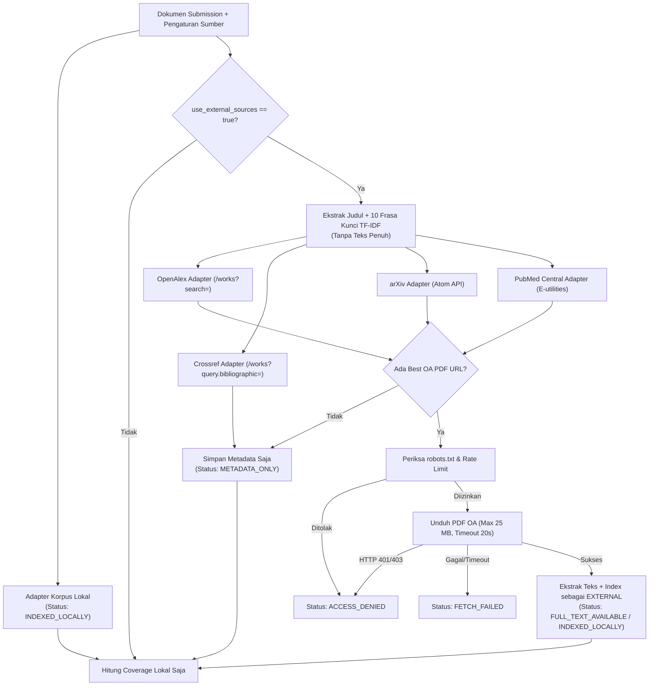

# Mesin Penemuan Sumber (Source Discovery) — NaskahGuard

## 1. Prinsip & Kebijakan Akses
- **Default Off untuk Sumber Eksternal**: Pemeriksaan default hanya membandingkan terhadap **Korpus Lokal**. Pencarian ke sumber eksternal (`use_external_sources = true`) hanya aktif jika diaktifkan secara sadar oleh pengguna.
- **Perlindungan Privasi Kueri**: NaskahGuard **tidak pernah mengirimkan isi dokumen penuh** ke penyedia eksternal. Kueri pencarian dibentuk hanya dari judul dokumen dan maksimal 10 frasa kunci hasil ekstraksi TF-IDF.
- **Kejujuran Cakupan**: Sumber yang hanya menyediakan metadata atau abstrak dicatat dengan status `METADATA_ONLY` dan **tidak pernah dihitung** sebagai dokumen *full-text* yang sudah dibandingkan.

## 2. Alur Penemuan Sumber

## 3. Aturan & Rate Limit Provider Resmi

| Provider | Endpoint Resmi | Autentikasi | Rate Limit & Aturan Polite Pool | Kemampuan Full-Text |
|---|---|---|---|---|
| **Local Corpus** | Internal Database | Lokal | Tidak ada | Penuh (`INDEXED_LOCALLY`) |
| **OpenAlex** | `https://api.openalex.org/works` | Tanpa API Key | ~10 req/detik, 100k/hari. Menggunakan parameter `mailto` (`CONTACT_EMAIL`) untuk *polite pool*. | Metadata + URL OA PDF bila tersedia (`best_oa_location.pdf_url`). |
| **Crossref** | `https://api.crossref.org/works` | Tanpa API Key | Menggunakan header `User-Agent: NaskahGuard/0.1 (mailto:...)` untuk *polite pool*. | `METADATA_ONLY` (judul, penulis, tahun, DOI, URL). |
| **arXiv** | `https://export.arxiv.org/api/query` | Tanpa API Key | Wajib jeda minimal **3 detik** antar permintaan sesuai pedoman arXiv API. | PDF preprint terbuka dari `arxiv.org/pdf/...` jika `robots.txt` mengizinkan. |
| **PubMed Central (PMC)** | `https://eutils.ncbi.nlm.nih.gov/entrez/eutils/` | Opsional API Key | Maksimal **3 req/detik** tanpa API key. | Metadata + tautan OA subset PMC bila tersedia melalui FTP/OA API. |

## 4. Antarmuka `SourceProvider`
Setiap adapter mengimplementasikan kelas abstrak `SourceProvider`:
- `search(query: str) -> list[SourceRecord]`
- `fetch_content(source_id: str) -> FetchedContent | None`
- `get_metadata(source_id: str) -> SourceRecord | None`

Setiap kueri ke provider eksternal dicatat ke tabel `provider_queries` (provider, kueri, status HTTP, jumlah hasil, durasi, error) untuk keperluan pemantauan dan audit.
